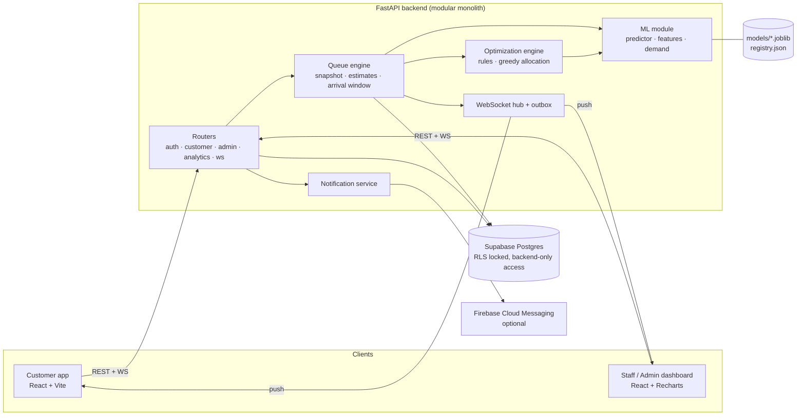

# QueueLess — System Architecture

## 1. Shape of the system

A **modular monolith** (one FastAPI deployable) plus a managed Supabase Postgres. The ML layer is an in-process module behind a narrow interface (`app/ml/predictor.py`); it can be moved behind HTTP later without touching callers. No extra microservices in v1.



### Service boundaries (who may call whom)

| Module | Owns | Depends on |
|---|---|---|
| `routers/*` | HTTP contracts, authz, pagination | services, engine |
| `services/queue_ops.py` | Transactional mutations + audit | engine, notifications |
| `engine/queue_engine.py` | Snapshot of the location, ordering, estimates, arrival windows, derived state persistence | `ml.*`, models |
| `engine/optimizer.py` | Alerts, recommendations (rules + greedy) | queue_engine, demand_service |
| `services/demand_service.py` | Arrival-lag features, forecasts, back-filling actuals | `ml.*` |
| `services/analytics.py` | KPI aggregation, reports (CSV/PDF), ML monitoring | models |
| `ml/features.py` | **Single source of truth** for feature definitions (train == serve) | none |
| `ml/predictor.py` | Load joblib bundles, batch inference, graceful fallback | `ml/features.py` |
| `realtime.py` | Outbox + WebSocket hub | none |

**ML is advisory.** `ml/*` is only called by the engine and demand service; queue order, eligibility, counter assignment and status transitions never read a prediction.

## 2. Request flow (customer joins)

```mermaid
sequenceDiagram
  participant U as Customer app
  participant API as FastAPI
  participant DB as Supabase Postgres
  participant ML as ML module
  participant S as Staff dashboard
  U->>API: POST /queue/join {service, priority}
  API->>DB: BEGIN; lock service row; check duplicate/cooldown
  API->>DB: INSERT queue_tokens (unique service/date/number) + queue_events
  API->>API: queue_engine.refresh(): snapshot → order → positions
  API->>ML: predict_wait_batch(features of all waiting tokens)
  ML-->>API: point + 80% interval (or None → labelled fallback)
  API->>DB: INSERT predictions (only if changed ≥ 2 min), notifications; COMMIT
  API-->>U: 201 TokenOut (position, ETA, range, arrival window)
  API--)U: WS token_update (after commit, via outbox)
  API--)S: WS queue_changed → dashboard refetch
  Note over API: Optimizer evaluated on GET /admin/alerts<br/>and shown as actionable recommendations
```

**Why an outbox?** DB code appends WebSocket messages to an `Outbox`; the endpoint flushes it as a `BackgroundTask` after the commit, so clients never receive state that was rolled back.

## 3. Real-time channel

* `GET /ws` — first message must be `{"type":"auth","token":"<JWT>"}` within 5 s (JWT never in the URL/logs).
* Server → client: `ready`, `token_update` (full `TokenOut`), `notification`, `queue_changed` (staff only).
* One socket per browser tab (`LiveProvider`); components subscribe with `useLiveEvent`. Clients also poll every 10–30 s as a safety net, so a dropped socket only degrades freshness.
* Scale note: hub is in-process. For >1 API instance, publish through Supabase Realtime or Redis pub/sub inside `Hub.flush`.

## 4. Resilience & fallback

| Failure | Behaviour |
|---|---|
| No model artifact / `ML_ENABLED=false` / inference error | Estimate switches to `fallback-v1` formula, flagged `method:"fallback"`, **no confidence range shown**; UI badge “Standard estimate (non-AI)”. Queue operations unaffected. |
| No eligible counter open | `method:"unavailable"`, no number is invented; critical alert with “Open Counter N” action. |
| WebSocket down | Auto-reconnect with back-off; pages poll. |
| FCM not configured | Notification stored + pushed in-app; `delivery_status=pending`. |

## 5. Security model

JWT (HS256, 12 h) · bcrypt · RBAC `customer/staff/admin` via dependencies · Pydantic validation · SQLAlchemy ORM (parameterised SQL) · CORS allow-list · per-IP sliding-window rate limit (stricter on `/auth/*`) · WebSocket first-message auth · audit log for overrides, counter/staff/setting changes · other customers' tokens return **404** (not 403) · Supabase **RLS enabled with no policies** (public REST API exposes nothing) · secrets only in env.

## 6. Folder structure

```
queueless/
├── README.md
├── docker-compose.yml
├── .env.example
├── docs/                      01-PRD … 08-TESTING
├── supabase/
│   └── migrations/0001_queueless_schema.sql      authoritative DDL
├── backend/
│   ├── Dockerfile · requirements.txt · .env.example · pytest.ini
│   ├── app/
│   │   ├── main.py            app factory, CORS, rate limit, error handler
│   │   ├── config.py · db.py · models.py · schemas.py · security.py · realtime.py
│   │   ├── routers/           auth · customer · admin · analytics · ws
│   │   ├── services/          queue_ops · notifications · demand_service · analytics · settings_service
│   │   ├── engine/            queue_engine · optimizer
│   │   └── ml/                features · simulation · predictor · calendar_utils
│   ├── models/                trained *.joblib + registry.json (committed demo artifacts)
│   ├── scripts/seed_demo.py   flagged demo data
│   └── tests/                 conftest · test_queue_flow
├── ml/
│   ├── common.py · train_wait_time.py · train_demand.py · retrain_wait_time.py
│   ├── notebooks/01_eda_and_wait_time.ipynb
│   └── reports/               wait_time_report.md/png/json · demand_report.md/json
└── frontend/
    ├── Dockerfile · nginx.conf · vercel.json · vite.config.js · .env.example
    └── src/
        ├── main.jsx           routes + nav
        ├── lib/               api · auth · live (WebSocket) · format · actions
        ├── components/        ui · Shell
        └── pages/             Landing · Login · customer/* · admin/*
```

## 7. Organizations (multi-location)

* **Scoping.** One request operates on one organization. `X-Location-Id` (sent by the web app) selects it; `get_db` stores it on the SQLAlchemy session (`db.info["location_id"]`) and `settings_service.get_location(db)` reads it. Anything addressed by id (a token, counter, service, staff member) **re-scopes the session to that object's own organization**, so a stale header can never mix data between sites.
* **Roles.** `admin` may operate on any organization; `staff` are pinned server-side to `staff.location_id` (the header is ignored and other organizations' tokens return 404); `customer` browses whichever active organization they choose.
* **Isolation.** Snapshots, queues, counters, services, thresholds (`location_settings`), analytics, demand forecasts and optimizer alerts are all per organization. Token numbers are already per service.
* **Templates.** `services/org_templates.py` seeds typical services/counters per type (hospital, college, bank, government, other). They are starting points only and fully editable.
* **Known limits.** WebSocket `queue_changed` events go to all connected staff (clients refetch only their own organization's data); there is no cross-organization comparison view yet; the demo seed populates only the first organization.
