# QueueLess — Database design (Supabase / PostgreSQL)

Authoritative DDL: [`supabase/migrations/0001_queueless_schema.sql`](../supabase/migrations/0001_queueless_schema.sql). SQLAlchemy models (`backend/app/models.py`) mirror it.

## ER diagram

```mermaid
erDiagram
  LOCATIONS ||--o{ SERVICES : offers
  LOCATIONS ||--o{ COUNTERS : has
  LOCATIONS ||--o{ LOCATION_SETTINGS : configures
  LOCATIONS ||--o{ SPECIAL_EVENTS : calendar
  USERS ||--o| STAFF : "is (role=staff)"
  USERS ||--o{ QUEUE_TOKENS : books
  USERS ||--o{ NOTIFICATIONS : receives
  USERS ||--o{ PUSH_DEVICES : registers
  USERS ||--o{ AUDIT_LOGS : performs
  STAFF |o--o| COUNTERS : "staffs (counters.assigned_staff_id, unique)"
  COUNTERS }o--o{ SERVICES : "counter_services"
  SERVICES ||--o{ QUEUE_TOKENS : "queue for"
  SERVICES ||--o{ DEMAND_FORECASTS : forecast
  COUNTERS |o--o{ QUEUE_TOKENS : "serves"
  QUEUE_TOKENS ||--o{ QUEUE_EVENTS : "append-only log"
  QUEUE_TOKENS ||--o| SERVICE_RECORDS : "timing facts"
  QUEUE_TOKENS ||--o{ PREDICTIONS : "estimates over time"
  QUEUE_TOKENS |o--o{ NOTIFICATIONS : about

  USERS { bigint user_id PK  text email "unique lower()"  text password_hash  user_role role  bool is_demo }
  SERVICES { bigint service_id PK  text service_name  text code "token prefix"  numeric average_service_duration  service_status status }
  COUNTERS { bigint counter_id PK  text counter_name  counter_status status  bigint assigned_staff_id FK "unique when set" }
  QUEUE_TOKENS { bigint token_id PK  int token_number "unique per service/day"  text token_label  int queue_position  priority_type priority_type  token_status status  bool is_demo  timestamptz created_at "queue entry"  timestamptz arrival_time }
  QUEUE_EVENTS { bigint event_id PK  text event_type  timestamptz timestamp  jsonb metadata }
  SERVICE_RECORDS { bigint record_id PK  timestamptz service_start_time  timestamptz service_end_time  numeric actual_service_duration  numeric actual_wait_minutes  smallint rating }
  PREDICTIONS { bigint prediction_id PK  numeric predicted_waiting_time  numeric prediction_lower_bound  numeric prediction_upper_bound  text method "ml or fallback"  text model_version  jsonb features }
  DEMAND_FORECASTS { bigint forecast_id PK  timestamptz interval_start  int horizon_minutes "30/60/120"  numeric predicted_arrivals  int actual_arrivals  text model_version }
```

## Deviations from the brief (and why)

| Brief | Implemented | Reason |
|---|---|---|
| `Counters.service_id` | `counter_services` join table | B3 requires a counter to support several service types |
| `Staff.assigned_counter` | derived from `counters.assigned_staff_id` (+ unique partial index) | one source of truth, no circular FK, enforces “one counter per staff member” |
| — | `locations`, `location_settings` | configurable thresholds (O1) and multi-location readiness |
| — | `audit_logs`, `push_devices`, `special_events` | audit of overrides, FCM tokens, holiday/special-event features |
| `Predictions` | + `method`, `features` | label fallback vs ML; feature snapshot for drift analysis and retraining audit |
| `Demand_Forecasts` | + `service_id`, `horizon_minutes` | per-service, per-horizon scoring |
| `Users` / `Queue_Tokens` | + `is_demo` | keeps demo data separable from real operational data |

## Integrity rules enforced in the database

* `unique (service_id, queue_date, token_number)` — no duplicate token numbers; join retries on conflict.
* **Partial unique index** `queue_tokens_one_active_uq (user_id, service_id) WHERE status IN (active…)` — duplicate bookings are impossible even under races.
* `unique counters_staff_uq (assigned_staff_id) WHERE NOT NULL`.
* Check constraints: positive durations, `service_end >= service_start`, forecast horizons ∈ {30,60,120}, rating 1–5.
* `queue_events` is append-only; status changes never overwrite history.
* RLS **enabled on every table with no policies**: only the backend’s direct Postgres connection can read/write.

## Indexes

Token lookups by `(service_id,status)`, `(user_id,created_at desc)`, `created_at`; events by `(token_id,timestamp)` and `(event_type,timestamp)`; records by `counter_id,service_start_time` and `service_start_time`; predictions by `(token_id, prediction_timestamp desc)`; notifications by `(user_id, created_at desc)`.

## Convention: waiting time

`actual_wait_minutes = service_start_time − queue_tokens.created_at` (queue entry). Stored on `service_records` when service completes so analytics and retraining never recompute it.

## Migration 0002 — organizations

`supabase/migrations/0002_organizations.sql` adds `locations.location_type` (`hospital|college|bank|government|other`), `locations.address`, `locations.is_active`, and `staff.location_id` (existing staff are assigned to the first location). Run it after `0001` in the Supabase SQL editor.
