# QueueLess — ML pipeline architecture

> **Everything trained so far uses SIMULATED data.** Numbers in `ml/reports/` measure how well a model recovers the simulator's dynamics, not how well it will predict a real service centre. Real-world accuracy is only reported by the live monitoring page from `predictions` joined to real `service_records` (`is_demo = false`).

```mermaid
flowchart LR
  SIM[Discrete-event simulator<br/>app/ml/simulation.py] --> RAW[(raw tokens + features<br/>ml/data/*.csv)]
  REAL[(Supabase: predictions.features<br/>+ service_records)] -.Phase 2.-> RAW
  RAW --> CLEAN[Clean · dedupe · censor cancelled/no-show · cap outliers]
  CLEAN --> SPLIT[Chronological split by date<br/>70 / 15 / 15]
  SPLIT --> BENCH[Benchmark: LR · RF · GBR · XGB · fallback · mean]
  BENCH --> SEL[Select on VALIDATION MAE]
  SEL --> CAL[Calibrate 80% interval<br/>residual quantiles per predicted-wait bin]
  CAL --> TEST[Evaluate once on TEST]
  TEST --> ART[joblib bundle + registry.json + report]
  ART --> SERVE[app/ml/predictor.py<br/>batch inference, graceful fallback]
  SERVE --> MON[ML monitoring: live MAE · coverage · drift]
  MON -.threshold.-> RETRAIN[ml/retrain_wait_time.py<br/>candidate → compare → promote]
```

## 1. Data: simulator, not formulas

`backend/app/ml/simulation.py` is an event-driven simulation: non-homogeneous Poisson arrivals (hour-of-day × day-of-week profiles, holidays, special-event days), lognormal service times per service and per-counter efficiency, 5 counters each supporting a subset of 4 services, random staff breaks (counter “unavailable”), priority dispatch, customer reneging, early cancellations and no-shows (which waste counter time). **Wait labels are measured** (`service_start − entry`), never computed from features. The same `compute_wait_features()` used in production builds the features, so there is no train/serve skew.

Known simulator limits: Poisson arrivals, stationary service-time distributions, no appointment slots, no multi-step journeys. Real data will differ — which is why retraining on real data is designed in.

## 2. Model 1 — waiting time (implemented)

| Item | Decision |
|---|---|
| Target | `actual_wait_minutes` (PRD §4). Cancelled / no-show tokens are *censored* → excluded |
| Features | `queue_length, customers_ahead, active_counters, busy_counters (Counter_Status), average_service_time, current_arrival_rate, hour, day_of_week, service_type (one-hot), historical_average_wait (previous 28 days only), staff_availability` |
| Leakage guards | features computed at queue entry from state only; `historical_average_wait` uses prior days; assertion that target/outcome columns are not features |
| Cleaning | dedupe, drop NaN, drop waits < 0 or > 240 min, winsorise **train** target at p99.5 |
| Split | chronological by date (no shuffling) |
| Candidates | LinearRegression (baseline), RandomForest, GradientBoosting (squared/absolute loss), XGBoost (squared/absolute), plus “predict mean” and the **non-ML fallback formula** as reference baselines |
| Selection | lowest validation **MAE** (primary); RMSE and R² reported; test set touched once |
| Uncertainty | 80 % interval = prediction + empirical 10th/90th residual percentile of the validation set, per predicted-wait quartile bin. Coverage on test is reported (≈ 80 % on the simulated data). Not a guarantee on real data |
| Output | point, lower, upper, `model_version`, `trained_on` (`synthetic` → shown to users as “trained on simulated data”) |

Latest numbers: see [`ml/reports/wait_time_report.md`](../ml/reports/wait_time_report.md) (regenerated by `python ml/train_wait_time.py`).

**Serving semantics.** The API asks “how long would someone in this position/state wait?” and reports it as *remaining* wait; it is recomputed on every queue change. If no eligible counter is open, **no estimate is produced** (the model never saw “all counters closed all day”).

## 3. Model 2 — demand forecasting (implemented)

Per-service arrivals over the next 30 / 60 / 120 minutes from 30-minute bins. Features: `hour_of_day, day_of_week, prev_1h, prev_3h, prev_day_same, prev_week_same, historical_demand (4-week mean), is_holiday, special_event, service_type`. Baselines: seasonal-naive (same window last week) and 4-week mean. Candidates: RandomForest, GradientBoosting, XGBoost; **selected per horizon** on validation MAE; reported MAE / RMSE / **WAPE** on a chronological test split. Prophet is an optional candidate (not installed by default). Forecasts are stored in `demand_forecasts` and scored automatically after the interval ends (predicted-vs-actual charts, WAPE on the monitoring page). Without a model the API returns the 4-week historical mean, labelled non-ML.

## 4. Model 3 — no-show (Phase 2, **not built**)

Needs real booking → arrival history; the simulator’s no-shows depend only on wait time, so a model trained on it would learn the simulator, not people. Design when data exists: Logistic Regression → RF → XGBoost classifiers on `booking_lead_time, hour, service_type, confirmation status (confirmed / “on my way”), reminder acknowledged, prior attendance rate`; handle imbalance with class weights; calibrate (isotonic / Platt); report precision, recall, F1, ROC-AUC, confusion matrix. Use: **extra reminders and capacity planning only — never skipping, deprioritising or denying service.**

## 5. Retraining (designed + scripted)

* Not per transaction. Trigger: ≥ 2,000 new *real* labelled rows **or** live MAE drift ratio > 1.2 for 7 days (shown on the monitoring page).
* `ml/retrain_wait_time.py` exports real rows (`predictions.features` × `service_records`, `is_demo=false`), trains a **candidate**, compares it with the current model on the same chronological hold-out, and only with `--promote` overwrites `wait_time_latest.joblib` and appends to `registry.json` (`trained_on: "real"`).
* Roll-back = point `wait_time_latest.joblib` at a previous versioned file (all versions are kept).

## 6. Model governance

`backend/models/registry.json` records version, algorithm, params, metrics, data description and a note that metrics are simulated. `GET /predictions/models` and the monitoring page expose it. `predictions.model_version` ties every stored estimate to the model that made it.
