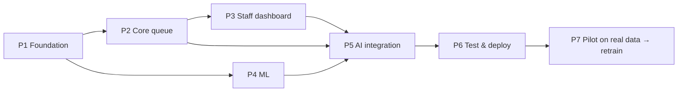

# QueueLess — Task breakdown with dependencies

Legend: ✅ done in this repository · 🟡 partly done · ⏳ not started. Durations are targets, not commitments.

| ID | Task | Depends on | Status | Where |
|---|---|---|---|---|
| **Phase 1 — Foundation (wk 1–2)** | | | | |
| 1.1 | PRD, assumptions, MVP scope | — | ✅ | `docs/01-PRD.md` |
| 1.2 | Architecture, ER, folder structure | 1.1 | ✅ | `docs/02`, `03` |
| 1.3 | Supabase schema + RLS migration | 1.2 | ✅ | `supabase/migrations` |
| 1.4 | Backend skeleton (config, db, models, security) | 1.3 | ✅ | `backend/app` |
| 1.5 | Frontend skeleton, design system, shell | 1.1 | ✅ | `frontend/src` |
| **Phase 2 — Core queue (wk 3–4)** | | | | |
| 2.1 | Auth (register/login/me), RBAC | 1.4 | ✅ | `routers/auth.py` |
| 2.2 | Services + discovery with live estimates | 1.4 | ✅ | `routers/customer.py` |
| 2.3 | Join / duplicate guard / priority / cooldown | 2.1, 2.2 | ✅ | `services/queue_ops.py` |
| 2.4 | Status machine, cancel, confirm-arrival | 2.3 | ✅ | same |
| 2.5 | Event log + fallback estimate + arrival window | 2.3 | ✅ | `engine/queue_engine.py` |
| 2.6 | Customer screens (home, join, token, history, notifications, profile) | 2.1–2.5, 1.5 | ✅ | `pages/customer` |
| **Phase 3 — Staff dashboard (wk 5–6)** | | | | |
| 3.1 | Staff queue ops (call/start/complete/no-show/override + audit) | 2.4 | ✅ | `routers/admin.py` |
| 3.2 | Counter + staff management, settings | 2.1 | ✅ | same |
| 3.3 | WebSocket hub + outbox | 2.4 | ✅ | `realtime.py`, `routers/ws.py` |
| 3.4 | Analytics (overview, traffic, wait, utilization, reports CSV/PDF) | 3.1 | ✅ | `services/analytics.py` |
| 3.5 | Admin screens | 3.1–3.4 | ✅ | `pages/admin` |
| **Phase 4 — ML (wk 7–8)** | | | | |
| 4.1 | Discrete-event simulator | 1.2 | ✅ | `app/ml/simulation.py` |
| 4.2 | Shared feature contract | 4.1 | ✅ | `app/ml/features.py` |
| 4.3 | Model 1 benchmark, calibration, registry | 4.1, 4.2 | ✅ | `ml/train_wait_time.py` |
| 4.4 | Model 2 benchmark (30/60/120) | 4.1, 4.2 | ✅ | `ml/train_demand.py` |
| 4.5 | EDA notebook | 4.1 | 🟡 | `ml/notebooks` (not executed — run it locally) |
| 4.6 | Model 3 no-show | real bookings | ⏳ Phase 2 | designed in `docs/04` |
| **Phase 5 — AI integration (wk 9–10)** | | | | |
| 5.1 | Batch inference in engine, fallback, labelled UI | 4.3, 2.5 | ✅ | `ml/predictor.py` |
| 5.2 | Demand forecasts stored + scored | 4.4, 3.4 | ✅ | `services/demand_service.py` |
| 5.3 | Rules engine + greedy allocation with actions | 5.1, 5.2 | ✅ | `engine/optimizer.py` |
| 5.4 | ML monitoring (live MAE, coverage, drift, WAPE) | 5.1, 5.2 | ✅ | `analytics.ml_monitoring` |
| 5.5 | FCM push | 3.3 | 🟡 | server adapter ✅; **web push client (Firebase JS + service worker) ⏳** needs your Firebase project |
| **Phase 6 — Test & deploy (wk 11–12)** | | | | |
| 6.1 | Automated backend tests | 2–5 | ✅ 11 tests | `backend/tests` |
| 6.2 | Frontend component / e2e tests | 3.5 | ⏳ | add Vitest + Playwright |
| 6.3 | Load test (WebSocket fan-out, join race) | 6.1 | ⏳ | target in PRD §7 |
| 6.4 | Docker, env templates | all | ✅ | `docker-compose.yml` |
| 6.5 | Deploy (Render/Railway API, Vercel web, Supabase DB) | 6.4 | ⏳ | `docs/07-DEPLOYMENT.md` |
| 6.6 | Security review (pen-test, rate-limit store, secret rotation) | 6.5 | ⏳ | |
| **Phase 7 — Pilot** | | | | |
| 7.1 | Run with real customers, `DEMO_MODE=false` | 6.5 | ⏳ | |
| 7.2 | Threshold retraining on real data | 7.1 | 🟡 script ready | `ml/retrain_wait_time.py` |
| 7.3 | Post-service rating capture (satisfaction KPI) | 7.1 | ⏳ | column exists |
| **Extensions** | | | | |
| X.1 | Digital-twin what-if simulator UI | 4.1 | ⏳ | simulator reusable |
| X.2 | Multi-location comparison | 7.1 | ⏳ | `location_id` in schema |
| X.3 | Horizontal scale: pub/sub for WS, Redis rate limit | 6.5 | ⏳ | |
