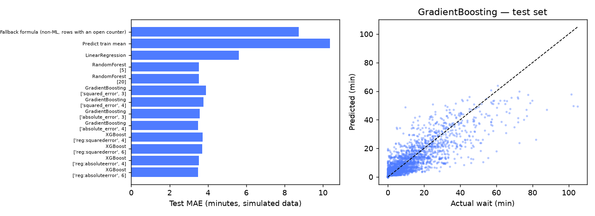

# Waiting-time model report

> **All metrics are from SIMULATED data** (discrete-event simulator, `backend/app/ml/simulation.py`). They are an engineering baseline, not evidence of real-world accuracy. Re-validate on real `service_records` before relying on them.

* Version: `wait-gradientboosting-20261118T142111Z`
* Rows (served tokens after cleaning): 23,458; train 16,213 / val 3,529 / test 3,716 (chronological by date, cutoffs 2025-04-14, 2025-05-05)
* Selection rule: lowest **validation MAE**; test set evaluated once.
* Target: `actual_wait_minutes = service_start − queue_entry` (PRD §4). Cancelled/no-show tokens are censored and excluded.

| Model | Params | Val MAE | Val RMSE | Val R² | Test MAE | Test RMSE | Test R² |
|---|---|---|---|---|---|---|---|
| GradientBoosting | `{"loss": "absolute_error", "max_depth": 4}` | 4.65 | 8.54 | 0.748 | 3.49 | 6.49 | 0.738 |
| XGBoost | `{"objective": "reg:absoluteerror", "max_depth": 6}` | 4.72 | 8.52 | 0.749 | 3.49 | 6.42 | 0.744 |
| RandomForest | `{"min_samples_leaf": 20}` | 4.72 | 8.45 | 0.753 | 3.52 | 6.41 | 0.744 |
| XGBoost | `{"objective": "reg:absoluteerror", "max_depth": 4}` | 4.72 | 8.49 | 0.751 | 3.54 | 6.44 | 0.741 |
| GradientBoosting | `{"loss": "absolute_error", "max_depth": 3}` | 4.73 | 8.64 | 0.742 | 3.58 | 6.53 | 0.735 |
| RandomForest | `{"min_samples_leaf": 5}` | 4.78 | 8.54 | 0.748 | 3.54 | 6.47 | 0.739 |
| XGBoost | `{"objective": "reg:squarederror", "max_depth": 4}` | 4.85 | 8.47 | 0.752 | 3.73 | 6.47 | 0.739 |
| GradientBoosting | `{"loss": "squared_error", "max_depth": 4}` | 4.87 | 8.49 | 0.750 | 3.77 | 6.49 | 0.738 |
| XGBoost | `{"objective": "reg:squarederror", "max_depth": 6}` | 4.88 | 8.59 | 0.744 | 3.70 | 6.55 | 0.733 |
| GradientBoosting | `{"loss": "squared_error", "max_depth": 3}` | 4.93 | 8.45 | 0.753 | 3.90 | 6.55 | 0.733 |
| LinearRegression | `{}` | 6.50 | 10.03 | 0.652 | 5.62 | 7.98 | 0.604 |
| Fallback formula (non-ML, rows with an open counter) | `{}` | 11.00 | 22.41 | -0.758 | 8.74 | 18.47 | -1.130 |
| Predict train mean | `{}` | 12.32 | 17.03 | -0.003 | 10.36 | 13.07 | -0.064 |

**Selected: GradientBoosting** — test MAE 3.49 min on all rows. On the 99.6% of test rows where the non-ML fallback is defined (an eligible counter is open) the model scores MAE 3.46 vs 8.74 for the fallback (improvement of 5.28 min).

**80% prediction interval:** empirical coverage on the test set = 80.4%, mean width 10.6 min (residual quantiles per predicted-wait bin, calibrated on the validation split).

## Permutation importance (test sample, ΔMAE)
* `customers_ahead`: 4.707
* `active_counters`: 2.262
* `busy_counters`: 0.937
* `average_service_time`: 0.369
* `queue_length`: 0.109
* `service_type`: 0.105
* `current_arrival_rate`: 0.023
* `hour`: 0.009
* `staff_availability`: 0.007
* `historical_average_wait`: 0.007
* `day_of_week`: 0.004

